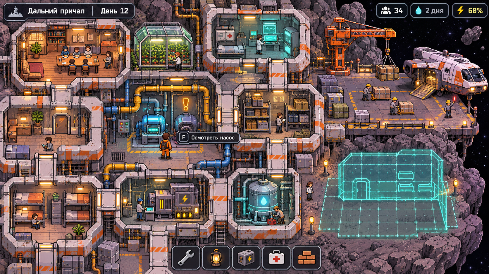

# Пульс Пустоты

Одиночная сюжетная 2D-игра о выживании и развитии поселения. [Запустить игру для Windows](<Пульс Пустоты.exe>) · [Открыть проект Godot](game/project.godot) · [Источники мира](ИСТОЧНИКИ.md)

**Решение от 24.11.2026.** Разработка игры ведётся в корне проекта. Telegram-игра закрыта. Канал «Великий архив» и связанные статьи сохраняют значение как источники мира.

## Принято · 23.11.2026

Первая версия рассчитана на одного игрока. Выживание, сюжет и развитие поселений составляют её основу. К вопросу кооператива можно вернуться позднее.

Движок игры — Godot 4.

## Начало игры · Принято 23.11.2026

3801 год. Герой прибывает эвакуационным рейсом в старый грузовой терминал на промышленной окраине Ориона. На причале его отмечают в списке прибывших. Ночевать ему и остальным пассажирам предстоит здесь. Война, беженцы и промышленная окраина Ориона описаны в архиве. Конкретный рейс и терминал придуманы для игры. [Мировая история](https://telegra.ph/Mirovaya-Istoriya-11-15) · [Система Орион](https://teletype.in/@inquisitordv/sLKp4socgkq)

Пока транспорт пришвартован, он питает причал. До его ухода игрок осматривает жилую секцию и мастерскую. На ночь можно запитать только одну из них. Если выбрать жилую секцию, у людей будут тёплые койки. Если выбрать мастерскую, утром заработает верстак, а первую ночь люди проведут в столовой. Утром игрок видит, как жители освоили выбранное помещение.

## Корабль у шлюза · Принято 23.11.2026

У соседнего шлюза стоит сломанный корабль. Герой видит его уже по прибытии. После ухода эвакуационного транспорта этот корабль остаётся у терминала. Игрок сможет выходить за пределы базы и постепенно чинить судно. Позднее на восстановленном корабле он сможет отправляться на другие планеты за провизией и припасами и привозить их домой. Полёты относятся к будущему развитию игры.

## Этап 1 · Прибытие и первое утро · Завершён 23.11.2026

Прототип собран для Windows на Godot 4.5.1 с GDScript. Чтобы сыграть, откройте [Пульс Пустоты.exe](<Пульс Пустоты.exe>). Для работы в редакторе откройте [проект Godot](game/project.godot).

Первый результат — играбельный визуальный прототип. Игрок осматривает причал, выбирает у щита, куда подать питание, и на следующее утро видит последствия для жителей. В каждой ветке он может сделать следующий шаг сам. Эпизод можно начать заново, чтобы пройти другую ветку. [Чат этапа](codex://threads/01a2096b-5ca8-7563-bdcc-6b0b0a21f028)

| Выбор вечером | Что видно утром | Что игрок пробует дальше |
|---|---|---|
| Жилая секция | Семьи обживают тёплые койки. Механик ждёт питания для верстака. | Бывшая работница терминала показывает служебный вход. Герой идёт с ней за кабелем для второй линии. |
| Мастерская | Жители убирают постели в столовой. У шлюза механик проверил корабельный блок и нашёл сгоревший разъём. | Герой меняет разъём у верстака и возвращает блок на корабль. В грузовом отсеке загорается свет. |

Эти два утра выбраны для игровой пробы. После прохождения можно уточнить реплики, маршрут за кабелем и последовательность ремонта. Для более позднего эпизода предлагались поиски кабеля в сервисном отсеке у внешнего шлюза и восстановление освещения в рубке.

Обе ветки прошли в сборке на текущем компьютере с Windows автоматической подачей клавиш. Проверены повторный старт, открытие и закрытие окна. [Прибытие](Кадры/01-прибытие.png) · [За кабелем с Ниной](Кадры/04-кабель.png) · [Свет на борту](Кадры/07-свет-на-борту.png)

## Что изменилось после первой сборки

- Игрок дошёл до сообщения о находке кабеля и ожидал продолжения. Находка завершает пробную ветку жилья. По обратной связи в обеих ветках появился экран «Прохождение завершено» с результатом и кнопками «Сыграть заново» и «В главное меню». [Финал жилья](Кадры/08-финал-жилой-секции.png) · [Финал мастерской](Кадры/09-финал-мастерской.png)
- Добавлены стартовое меню и спокойная электронная музыка. На причале музыка становится тише, слышен гул станции. Меню проверяли мышью и клавиатурой, обе кнопки — в каждом финале. [Стартовое меню](Кадры/00-стартовое-меню.png)
- По просьбе игрока переработаны походка и звук. При движении вбок герой поворачивается в профиль и переносит вес с ноги на ногу. При беге шаг удлиняется, корпус наклоняется. Шесть звуков из присланной игроком записи `fast-walking-on-a-concrete-surface.mp3` звучат в момент касания пятки. При остановке шаги затихают. В последней Windows-сборке проверяли восемь направлений движения, бег, остановки и оба сюжетных пути. [Видео со звуком](<Кадры/Шаги на палубе.mp4>)

**Управление.** Стрелки или `WASD` — движение, `Shift` — бег, `F` — взаимодействие, `Enter` — подтверждение выбора, `M` — переключение звука.

**Граница готового эпизода.** Кабель найден, но подключение второй линии остаётся за пределами прототипа. В мастерской восстановлено освещение грузового отсека. Дальнейший ремонт корабля, полёты за припасами и развитие нескольких поселений относятся к замыслу игры.

**История разработки.** В [чате выбора движка и концепции](codex://threads/01a20934-8f51-73d1-929c-c5a03680a125) обсуждались кооператив, переход к одиночной первой версии и два варианта утра. В [чате разработки первого эпизода](codex://threads/01a2096b-5ca8-7563-bdcc-6b0b0a21f028) находятся ход реализации, проверки сборки и последующие правки по впечатлениям от прохождения. Датированные решения, результаты проверок и открытые вопросы дальше ведём здесь.

## Что предстоит решить

После переноса 24.11.2026 сверены контрольные суммы 91 файла игры. Сборка из корня загрузила сцену причала и главное меню. При автоматическом выходе код завершения — 0, но Godot сообщил, что два ресурса фоновой музыки оставались занятыми. Оба сюжетных пути проверялись до переноса.

- Для первого варианта предложены компьютер, вид сверху и управление с клавиатуры. Целевые устройства и художественный стиль ещё можно менять.
- Тип корабля, дальнейшие этапы ремонта и первый маршрут полёта остаются открытыми.
